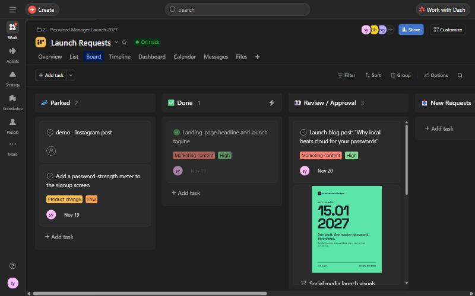
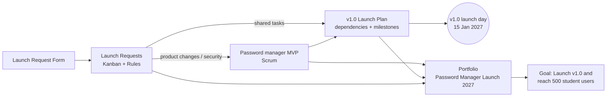
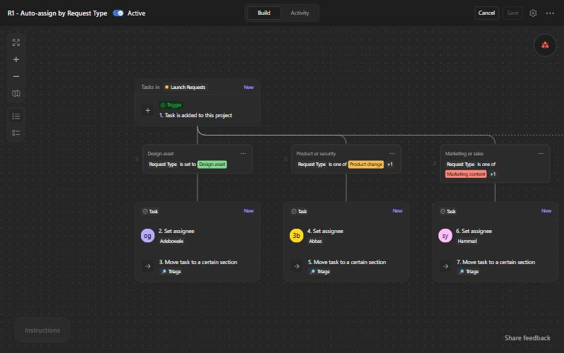
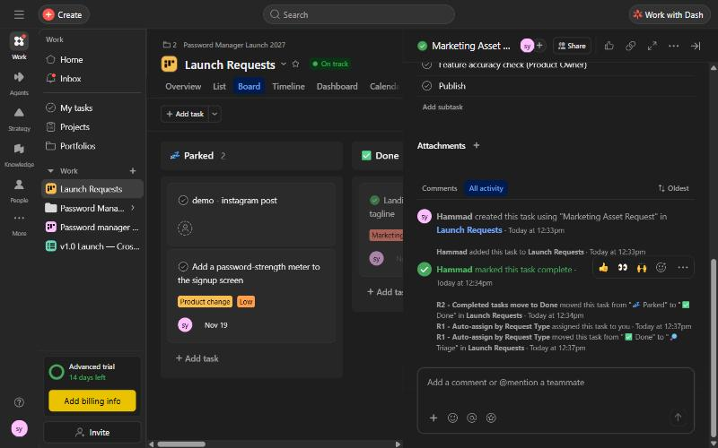
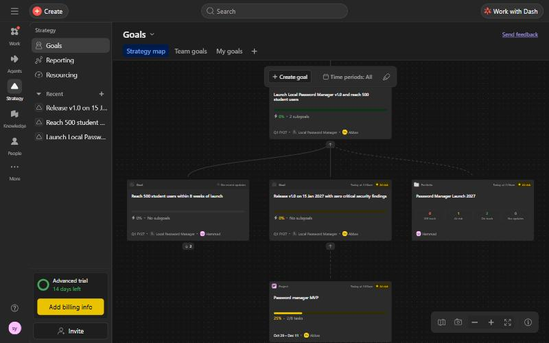
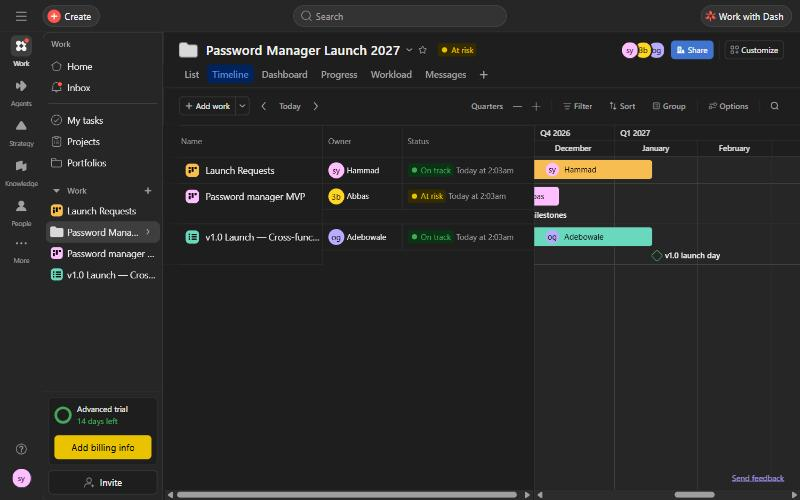

<div align="center">

# 🔐 Local Password Manager: Agile Project Management in Asana

**How a cross-functional team plans, automates and steers a product launch with Scrum, Kanban and Asana**


[📄 Read the report (PDF)](REPORT.pdf) · [📝 Report (Markdown)](REPORT.md) · [🖼️ Screenshots](screenshots/) · [📚 Docs](docs/)

</div>

---

## Table of contents

- [About](#about)
- [The product](#the-product)
- [Team and roles](#team-and-roles)
- [How the Asana workspace is built](#how-the-asana-workspace-is-built)
- [Highlights](#highlights)
- [Repository structure](#repository-structure)
- [How to use this repository](#how-to-use-this-repository)
- [What we learned](#what-we-learned)
- [Disclaimer](#disclaimer)

---

## About

This repository documents our final exam project for **Agile Project Management**. The exam is a 15-minute **live demonstration in Asana** (no slides), followed by an individual Q&A.

We simulated a real company launching a new product. Four departments have to coordinate in one connected Asana workspace:
- Product Management
- Design
- Marketing
- Sales

Along the way, requirements change, stakeholders need updates, and repetitive work is automated.



## The product

> **Product Vision:** For students and individuals who manage many online accounts but don't want their passwords in someone else's cloud, the **Local Password Manager** is a simple, offline vault. It keeps all credentials encrypted on the user's own device behind one master password.

> **High-Level Product Goal:** Launch **v1.0 on 15 January 2027** with **zero critical security findings**, and reach **500 student users within 8 weeks** of launch.

| | |
|---|---|
| **Agile Value** | *Responding to change over following a plan* |
| **Agile Principle** | *Business people and developers must work together daily throughout the project* |

## Team and roles

| Person | Name | Responsibility | Main Asana area |
|---|---|---|---|
| 1 | Adebowale | Cross-functional agile collaboration | v1.0 Launch — Cross-functional Plan |
| 2 | **Hammad** | **Workflow automation & process optimization** | **Launch Requests** (form, fields, template, rules, dashboard) |
| 3 | Abbas | Portfolio management & strategic alignment | Goals, Portfolio, Password manager MVP (Product Owner) |

## How the Asana workspace is built

| Asana item | Purpose | Agile method |
|---|---|---|
| **Password manager MVP** | Build the product: Product Backlog, Sprint 1, user stories, QA, security risks | **Scrum** |
| **Launch Requests** | Single intake for all launch requests, with automation | **Kanban** |
| **v1.0 Launch — Cross-functional Plan** | Coordinate four departments with dependencies, approvals and milestones | Cross-functional board |
| **Portfolio "Password Manager Launch 2027" + Goals** | Connect all three projects to the company goal | Agile portfolio management |



## Highlights

**⚙️ Workflow automation (Person 2)**
- **One form:** the single front door for every request, with Request Type and Priority required.
- **Rule R1:** auto-assigns each request by Request Type and moves it to Triage, where a human checks it.
- **Rule R2:** moves completed tasks to Done.
- **Task template:** "Marketing Asset Request", with a Definition of Done and 4 subtasks.
- **Dashboard:** showed us the real bottleneck, which is approvals.

| Rule R1: auto-assign by Request Type | Activity log: R1 and R2 at work |
|---|---|
|  |  |

**🤝 Cross-functional collaboration (Person 1)**
- Dependencies across departments lead up to a Go / No-Go approval and the launch-day milestone.
- New stakeholder requests are handled openly, with comments and @mentions.

**🎯 Strategic alignment (Person 3)**
- A company goal with 2 sub-goals, linked to the projects and a portfolio.
- A portfolio with a roadmap, status updates and a dashboard.

| Goals: Strategy map | Portfolio roadmap |
|---|---|
|  |  |

## Repository structure

```
.
├── README.md                          ← you are here
├── REPORT.pdf                         ← designed report (17 pages, clickable contents)
├── REPORT.md                          ← full report in Markdown (all 32 screenshots)
├── docs/
│   ├── README.md                      ← index of all documents
│   ├── person-2-workflow-automation.md← deep dive: form, fields, template, rules, monitoring
│   ├── qa-preparation.md              ← exam questions with short and full answers
│   ├── one-page-reference-guide.md    ← group one-pager: Asana for agile teams
│   └── Person2_Script_Hammad.pdf      ← live-demo script (what to click, what to say)
├── screenshots/
│   ├── README.md                      ← gallery with captions
│   └── p1-*, p2-*, p3-*.jpg           ← Person 1 / 2 / 3 screenshots
├── CHANGELOG.md
└── .gitignore
```

## How to use this repository

| If you want to… | Open |
|---|---|
| Read everything in one designed document | [`REPORT.pdf`](REPORT.pdf) |
| Browse the report on GitHub, with diagrams | [`REPORT.md`](REPORT.md) |
| Understand the workflow automation in detail | [`docs/person-2-workflow-automation.md`](docs/person-2-workflow-automation.md) |
| Prepare for the Q&A | [`docs/qa-preparation.md`](docs/qa-preparation.md) |
| See every Asana screen | [`screenshots/`](screenshots/) |

**To rebuild the setup in your own Asana:** the step-by-step details (sections, field options, rule logic, template content and form questions) are in the [Person 2 deep dive](docs/person-2-workflow-automation.md) and in [section 3 of the report](REPORT.md#s3). Goals, Portfolios, Forms and Rules need an Asana paid plan or trial.

## What we learned

- **Asana is excellent at managing workflow.** Forms, fields and rules turn a messy inbox into a self-routing pipeline.
- **Scrum and Kanban work best together.** Scrum gives product development rhythm, Kanban keeps launch requests flowing, and Triage protects the sprint.
- **Transparency is what makes agile work.** Dependencies, Goals and Portfolios connect one request to the company goal.
- **Tools support agility, but people create it.** Approvals and retrospectives stay human.

Read the full reflection in [section 14 of the report](REPORT.md#s14).

## Disclaimer

This is a **university exam project**:
- The company and the product are fictional examples.
- No real passwords or personal data are stored anywhere in this repository or in the Asana workspace.
- Personal email addresses were replaced with first names in all screenshots.
- Asana is a trademark of Asana, Inc. This project is not affiliated with or endorsed by Asana.

<div align="center"><sub>Group G2 · Agile Project Management · WS 2026/27</sub></div>
