# Project Report: Local Password Manager v1.0 Launch in Asana

**Course:** Agile Project Management (Asana), final exam, WS 2026/27, Group G2  
**Team:** Hammad (Person 2: Workflow Automation), Adebowale (Person 1: Cross-functional Collaboration), Abbas (Person 3: Portfolio & Strategic Alignment)  
**Tool:** Asana (Advanced trial), workspace "Local Password Manager"  

---

## Contents

1. [Assignment and scenario](#s1)
2. [Shared group foundation](#s2)
3. [How the Asana workspace is structured](#s3)
4. [Agile methods used](#s4)
5. [Person 1: Cross-functional collaboration (Adebowale)](#s5)
6. [Person 2: Workflow automation & process optimization (Hammad)](#s6)
7. [Person 3: Portfolio & strategic alignment (Abbas)](#s7)
8. [How everything connects](#s8)
9. [Presentation plan (15 minutes)](#s9)
10. [Presentation script](#s10)
11. [Q&A answers prepared from the script](#s11)
12. [Evaluation: strengths, limitations, when to use another tool](#s12)
13. [Lessons learned and next steps](#s13)
14. [Reflection: what we learned](#s14)

---

## 1. Assignment and scenario

The task was to show, **live in Asana and without slides**, how an agile team can collaborate, organise work, adapt to change, improve workflows and connect daily work to strategy.

**The scenario:** a company prepares to launch a new product, and four departments have to coordinate:
- Product Management
- Design
- Marketing
- Sales

Along the way, requirements and priorities change, stakeholders need regular updates, and repetitive work should be automated.

**Format:** a 15-minute group demo, about 5 minutes of individual Q&A, and a one-page Asana reference guide.  

**Our product:** the **Local Password Manager**, an offline password vault for students and individuals who don't trust the cloud with their passwords.

---

## 2. Shared group foundation

### Product Vision
> For students and individuals who manage many online accounts but don't want their passwords in someone else's cloud, our Local Password Manager is a simple, offline vault that keeps all credentials encrypted on the user's own device behind one master password.

What the vision covers:
- **What we build:** an offline, encrypted password vault.
- **For whom:** students and individuals with many accounts who distrust cloud storage.
- **Problem solved:** password overload without handing secrets to a third-party server.
- **Value:** privacy and control, with no account, no server, and no data leaving the device.
- **Direction:** become the privacy-first password tool for students. Features like encrypted local backup or browser autofill come only after the secure core is proven.

### High-Level Product Goal
> Launch version 1.0 on **15 January 2027** with **zero critical security findings**, and reach **500 student users within 8 weeks** of launch.

The vision explains why we build the product and for whom, so it helps us say no. For example, there is no cloud sync in v1.0. The goal makes the vision measurable through a fixed date, a quality bar and a user target. Every task and request is prioritised by how much it helps that goal.

Both are documented in the overview of each project and in **Asana Goals**.

### Agile Value and Principle

| | Choice | Why we chose it | How Asana supports it |
|---|---|---|---|
| **Value** | Responding to change over following a plan | A launch with four departments always meets new requirements | One intake form, rules that route requests in seconds, a Parked section, and timeline and dependencies that show the impact of a change |
| **Principle** | Business people and developers must work together daily | No department can launch alone | Shared projects, comments and @mentions, approvals, and tasks that live in two projects at once |

---

## 3. How the Asana workspace is structured

| Item | Type | Owner | Status (12 Nov 2026) |
|---|---|---|---|
| Password manager MVP | Project (Scrum) | Abbas | At risk, 25 % complete |
| v1.0 Launch — Cross-functional Plan | Project (cross-functional board) | Adebowale | On track, 11 % complete |
| Launch Requests | Project (Kanban intake + automation) | Hammad | On track, 22 % complete |
| Password Manager Launch 2027 | Portfolio containing all 3 projects | Abbas | At risk |
| Launch Local Password Manager v1.0 and reach 500 student users | Company goal, with 2 sub-goals | Abbas | On track |

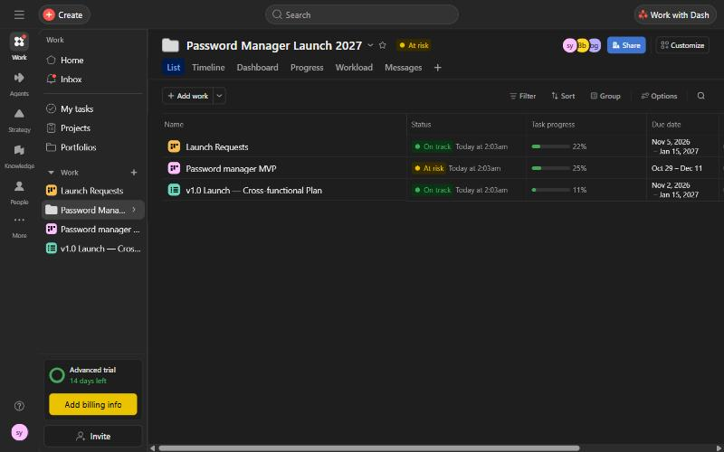

---

## 4. Agile methods used

We used a **hybrid approach**:

| Method | Where | Why |
|---|---|---|
| **Scrum** | Password manager MVP | Building software needs a time-boxed plan with a Sprint Goal, a Product Owner and a backlog |
| **Kanban** | Launch Requests | Requests from Marketing, Sales and Design arrive at any time and can't wait for the next sprint, so they need continuous flow |
| **Cross-functional board** | v1.0 Launch Plan | Four departments coordinate handovers, using dependencies, approvals and milestones |
| **Agile portfolio management** | Portfolio + Goals | Shows whether all of this work moves us toward the launch goal |

**Triage protects the sprint.** A product change that comes in through the form goes to the Product Owner first, and only the Product Owner decides whether it enters the Scrum Product Backlog.

**Scrum elements in Asana:**

| Scrum element | Where in Asana |
|---|---|
| Product Backlog | "Product Backlog" section |
| Sprint Backlog | "Sprint 1 - To Do" section |
| Sprint Goal | Project overview, point 10: "Validate the core password-vault user journey and define the initial security requirements" |
| User stories | USER-01 (unlock the vault), USER-02 (save a credential), USER-03 (search credentials), each with acceptance criteria |
| Definition of Done | Acceptance criteria plus the QA-01 test checklist |
| Product Owner | Abbas, the project owner |

**Scrum events and Asana:**

| Event | How well Asana supports it |
|---|---|
| Sprint Planning | Best fit: move stories into the sprint section and set owners and dates |
| Sprint Review | Best fit: status updates, dashboards and the portfolio |
| Daily Scrum | Supported: the team looks at the board together. The conversation still happens face to face |
| Retrospective | Weakest fit: there's no retro board, so we only record the agreed actions as tasks |

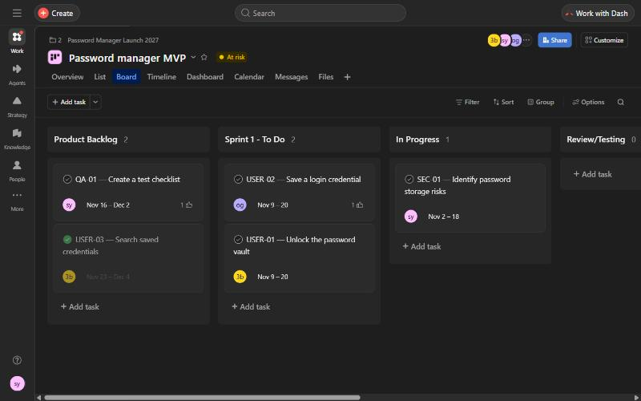

---

## 5. Person 1: Cross-functional collaboration (Adebowale)

**Project:** v1.0 Launch — Cross-functional Plan, with 18 tasks.

**Sections:** Backlog & New Requests → To Do → In Progress → Review / Approval → Done, plus Launch milestones.

What it shows:
- **Shared project, List and Board views, owners per department.** Every task name starts with its department, such as `[Design]`, `[Marketing]`, `[Sales]` or `[Product]`.
- **Comments and @mentions, feedback, and approvals.** "Approve launch email copy" and the **Go / No-Go decision** are Asana *approval* tasks.
- **Dependencies across departments:**
  - Design hands over assets, then Marketing writes the launch email, then the Product Owner approves it.
  - Security review, release notes, email approval and landing page all feed the Go / No-Go decision (12 Jan), which feeds the **v1.0 launch day milestone** (15 Jan).
- **Agile adaptation:** new stakeholder requests enter the Backlog & New Requests section, get an owner and a priority, and are discussed in comments. Two examples:
  - **Data-protection FAQ for university IT offices:** requested by Sales after feedback from two universities.
    - The Product Owner accepted it into v1.0 with High priority, because proof that nothing leaves the device is our strongest selling point.
    - The demo script now depends on it, and the social media campaign was moved down in priority.
    - The decision and its impact are written in the task description, and the change log is a comment that @mentions the people affected.
  - **Referral campaign with student ambassadors:** still waiting in Backlog & New Requests for prioritisation.
- **Transparency:** tasks such as "Social media launch visuals" live in both this project and Launch Requests, so there are no copies.

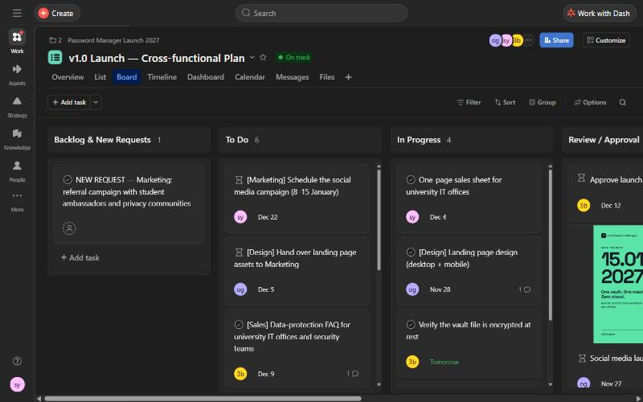

**List view: owners, due dates, priority, and the hourglass icon for blocked tasks:**

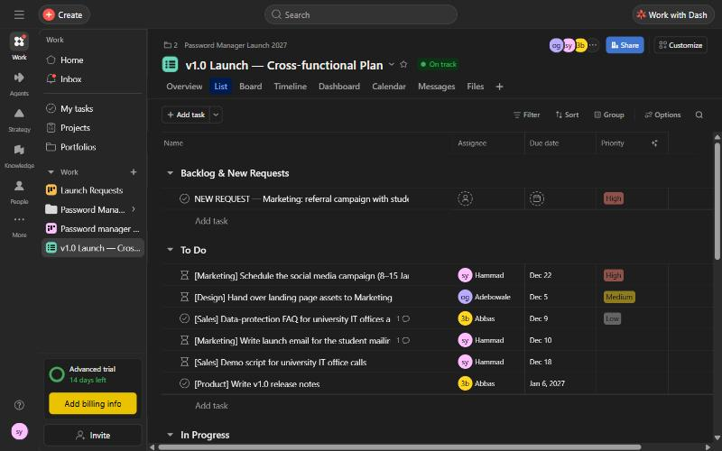

**A new stakeholder request handled in Asana:** the owner, the blocking dependency, the decision and its impact on the plan, and a change-log comment with @mentions.

| Request, owner and dependency | Decision and impact | Comment with @mentions |
|---|---|---|
| 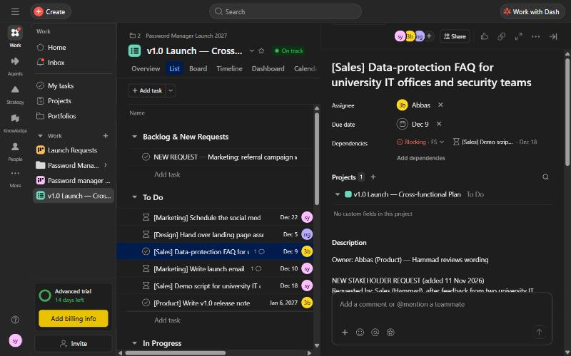 | 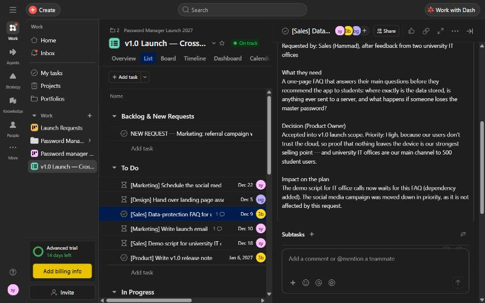 | 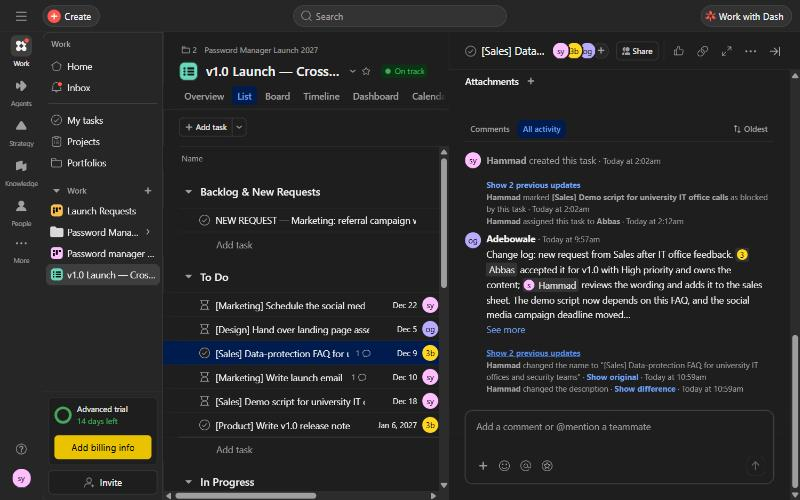 |

**Dependencies and approval, as seen on the Go / No-Go decision task:**

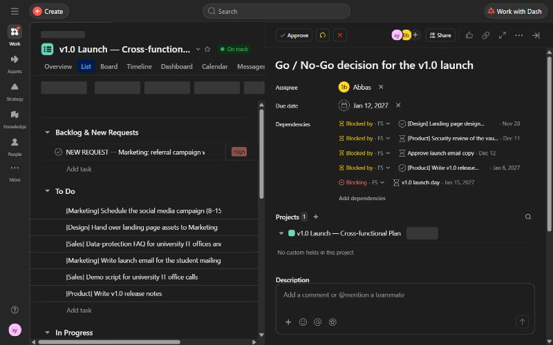

**Timeline with dependency arrows:**

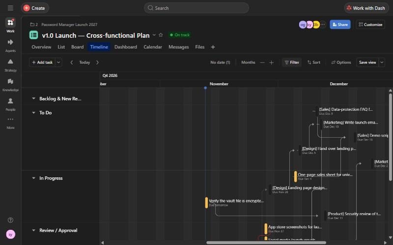

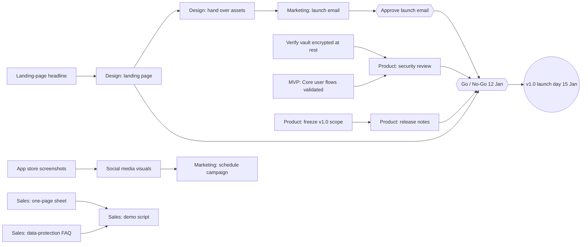

---

## 6. Person 2: Workflow automation & process optimization (Hammad)

> The full deep dive is in [docs/person-2-workflow-automation.md](docs/person-2-workflow-automation.md). A summary follows.

**Problem from the scenario:** the team spent too much time manually assigning tasks, following up on requests and updating the workflow.

**Solution:** the **Launch Requests** project. Every request enters through one form, gets structured by custom fields, and is routed and moved by rules.

| Requirement | What I built | Screenshot |
|---|---|---|
| Workflow stages | New Requests → Triage → In Progress → Review / Approval → Done, plus Parked | [board](screenshots/p2-01-board-left.jpg), [board 2](screenshots/p2-02-board-right.jpg) |
| Custom fields | **Request Type** (Design asset, Marketing content, Sales material, Product change, Security issue) and **Priority** (High, Medium, Low) | [list view](screenshots/p2-03-list-custom-fields.jpg) |
| Task template | **Marketing Asset Request**: goal, target audience, Definition of Done, 4 subtasks | [template](screenshots/p2-09-template-task.jpg), [subtasks](screenshots/p2-10-template-subtasks.jpg) |
| Form | **Launch Request Form** with 5 required questions, feeding the New Requests section | [form icon](screenshots/p2-11-form-icon.jpg), [public form](screenshots/p2-12-public-form.jpg) |
| Automation 1 | **R1: auto-assign by Request Type** (Design → Adebowale, Product/Security → Abbas, Marketing/Sales → Hammad), then move to Triage | [R1](screenshots/p2-07-rule-r1.jpg) |
| Automation 2 | **R2: completed tasks move to Done** | [R2](screenshots/p2-08-rule-r2.jpg) |
| Monitoring | Dashboard showing incomplete tasks by section, completion status and overdue tasks | [dashboard](screenshots/p2-04-dashboard-customize.jpg) |

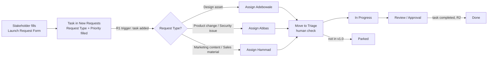

**Proof that the rules run:** the activity log of a task created from the template shows "R1 - Auto-assign by Request Type assigned this task" and "R2 - Completed tasks move to Done moved this task", with no human involved.

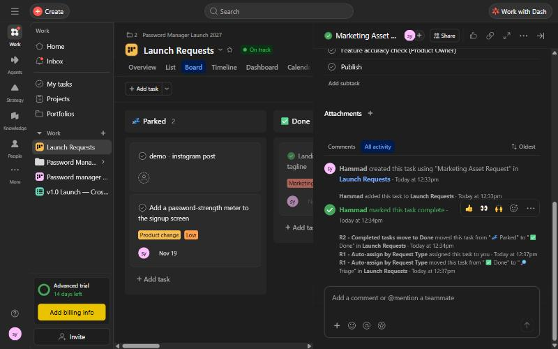

| Board | Dashboard |
|---|---|
| 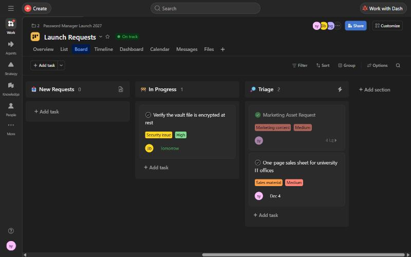 | 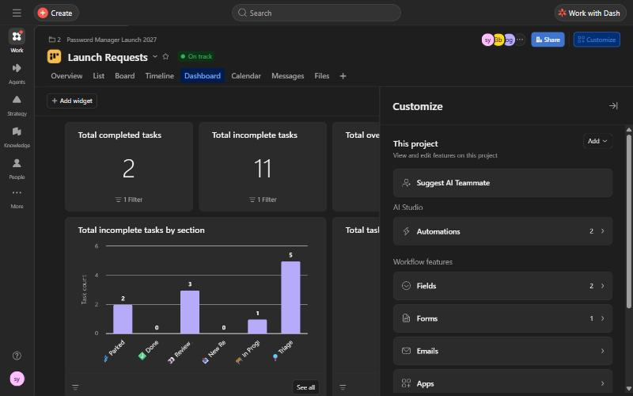 |

**Monitoring and continuous improvement:**
- **Manual effort removed:** collecting requests from email or chat, typing them in, deciding the owner, assigning, moving between stages and moving to Done.
- **Bottleneck found:** Review / Approval holds the most waiting tasks (3), so the bottleneck is approvals, not the work itself.
- **Limitation of automation:** wrong input gives wrong output. A wrong Request Type routes the task to the wrong person, too many rules create notification noise, and rule logic is hidden from new members.
- **Improvements:**
  - A rule that moves reopened tasks back to In Progress.
  - A reminder when a task sits in Review for more than 2 days.
  - A daily approval slot for the Product Owner.
  - Reviewing the rules in every retrospective.

**Reflection: which automation features give the greatest value, and what should teams consider first?**
Forms, custom fields and rules give the most value when they work together. The form is one front door, the fields structure each request, and the rules route it instantly and consistently. Before automating, check four things:
1. The process is stable.
2. The input is reliable (required fields).
3. Humans keep the key decisions (Triage and approvals).
4. The rules are reviewed regularly.

> My full live-demo walkthrough, with what I click and what I say, is in [section 10](#s10).

---

## 7. Person 3: Portfolio & strategic alignment (Abbas)

**Goals (Strategy map):**
- **Company goal:** *Launch Local Password Manager v1.0 and reach 500 student users*. Owner Abbas, On track.
  - **Sub-goal 1:** *Release v1.0 on 15 Jan 2027 with zero critical security findings*. At risk, linked to Password manager MVP.
  - **Sub-goal 2:** *Reach 500 student users within 8 weeks of launch*. Linked to the launch plan and Launch Requests.

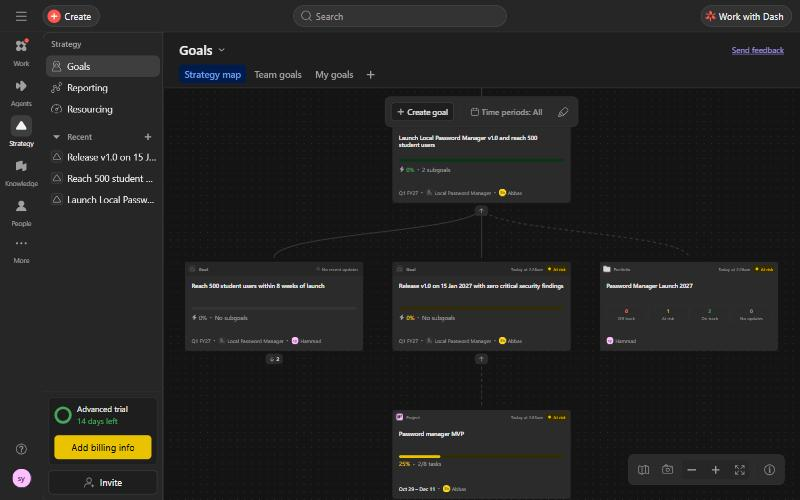

| Company goal: owner, period, accountable team, status | Progress and the 2 connected sub-goals |
|---|---|
| 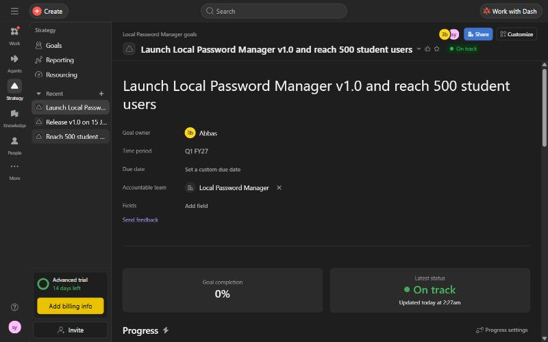 | 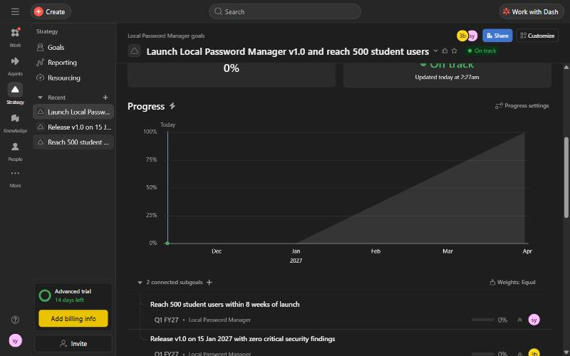 |

**The Scrum project behind sub-goal 1 (Password manager MVP):**

| Overview with "At risk" status update | Sprint 1 Goal and the agile method |
|---|---|
| 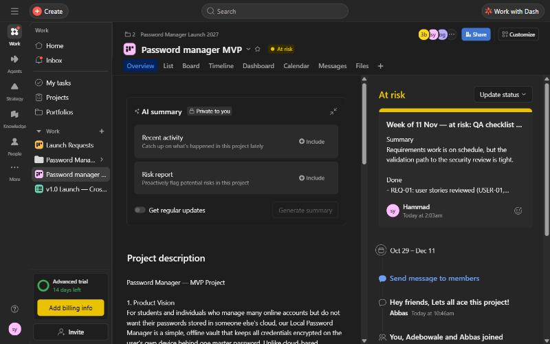 | 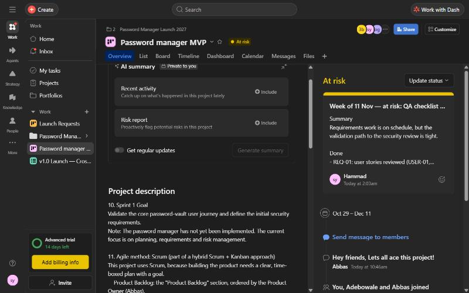 |

**MVP timeline:** user stories and SEC-01 flow into the *Requirements approved* milestone.

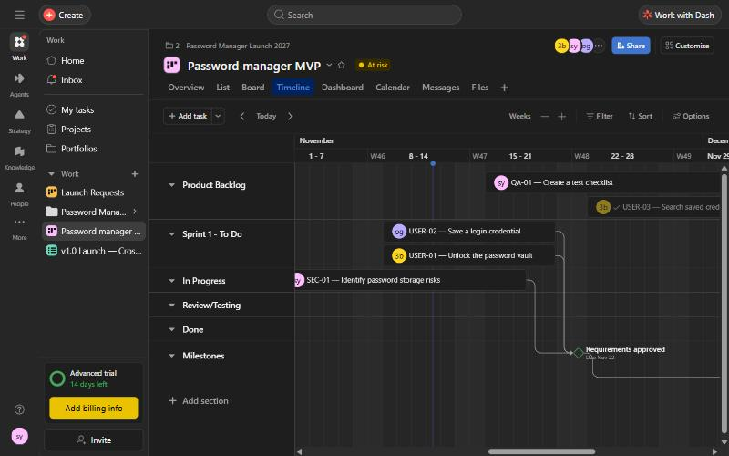

**Portfolio "Password Manager Launch 2027":**
- Contains all 3 projects, with status, progress and owner for each.
- **Timeline / roadmap:** each project's date range, plus the **v1.0 launch day** milestone.
- **Dashboard:** 34 tasks in total, 5 completed, 0 overdue, and projects by status (2 On track, 1 At risk).

| Roadmap | Portfolio dashboard |
|---|---|
| 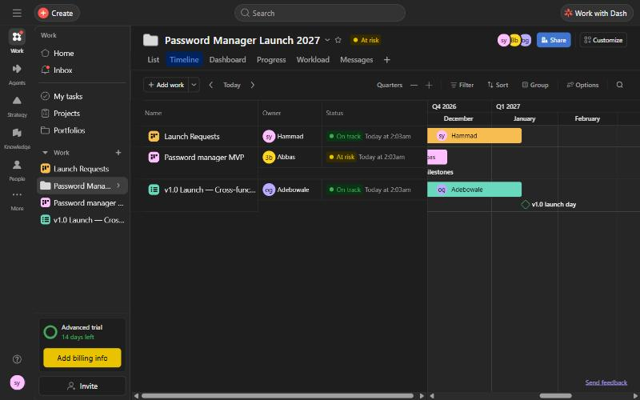 | 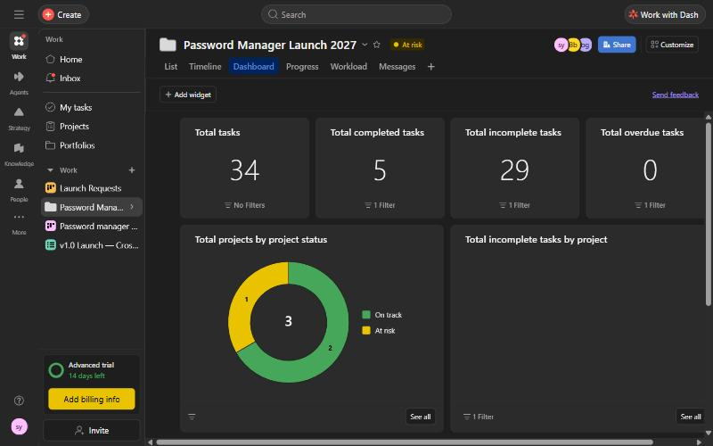 |

**Milestones:** Requirements approved (22 Nov) → Core user flows validated (4 Dec) → Security review (11 Dec) → Go / No-Go (12 Jan) → **v1.0 launch day (15 Jan 2027)**.

**Spotting delays and risks:** the MVP status update reads "At risk: QA checklist not started yet". If QA slips by a week, the security review and then the Go / No-Go decision come under pressure. The dependency chain makes this visible across projects.

---

## 8. How everything connects

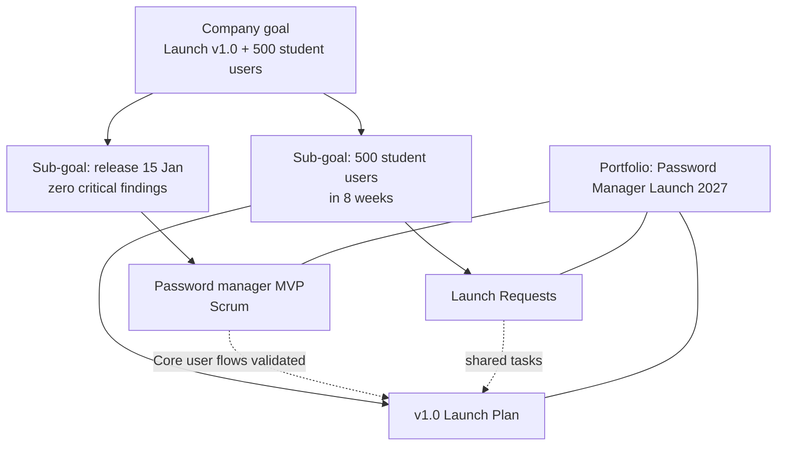

Here is how one request travels end to end:
1. **Daily work:** a request enters through the **form** (Person 2).
2. **Collaboration:** the request becomes part of the **cross-functional dependency chain** (Person 1).
3. **Strategy:** the chain ends in the **launch milestone** that the **portfolio and goals** report on (Person 3).

> "From one request in a form to a company goal: that is how Asana connects daily work to strategy for our launch."

---

## 9. Presentation plan (15 minutes)

| Time | Who | What |
|---|---|---|
| 0:00–1:30 | All | Scenario (Abbas), vision and goal (Hammad), direction (Adebowale), value and principle (Abbas) |
| 1:30–6:00 | Adebowale | Launch plan: views, assignment, comments, dependencies, approvals, new stakeholder request |
| 6:00–10:30 | Hammad | Launch Requests: stages, fields, template, form, R1, R2, dashboard, limitation, improvement, reflection |
| 10:30–14:30 | Abbas | Goals, portfolio, timeline and milestones, status updates, dashboard, risks |
| 14:30–15:00 | Abbas | Group closing |

---

## 10. Presentation script

The demo is fully scripted, so it fits into 15 minutes and every feature is tied to the same launch. The full printable version of my part is in [docs/Person2_Script_Hammad.pdf](docs/Person2_Script_Hammad.pdf).

### 10.1 Group part (about 90 seconds, one block each)

**Abbas (scenario):**
> "Our company is preparing the launch of a new product: the Local Password Manager v1.0. Product Management, Design, Marketing and Sales have to coordinate their work, requirements and priorities change, stakeholders need regular updates, and repetitive work should be automated. We built one connected example in Asana to show how an agile team handles that."

**Hammad (vision and goal):**
> "Our Product Vision: for students and individuals who manage many online accounts but don't want their passwords in someone else's cloud, our Local Password Manager is a simple, offline vault that keeps all credentials encrypted on the user's own device behind one master password. Our High-Level Product Goal: launch version 1.0 on 15 January 2027 with zero critical security findings, and reach 500 student users within 8 weeks of launch."

**Adebowale (direction):**
> "The vision tells us why we build it and for whom, so it helps us say no: for example, no cloud sync in version 1.0. The goal makes the vision measurable: a fixed date, a quality bar and a user target. Every task and request is prioritised by how much it helps that goal. Both are documented in the overview of our Password manager MVP project and in Asana Goals."

**Abbas (value and principle):**
> "We chose the Agile value responding to change over following a plan, because a launch with four departments always meets new requirements. And the principle business people and developers must work together daily, because no department can launch alone. Adebowale shows how we coordinate change, Hammad shows how we automate it, and I show how it connects to our strategic goal."

**Group closing (Abbas):**
> "From one request in a form to a company goal: that is how Asana connects daily work to strategy for our launch."

### 10.2 My live demo (Person 2, about 5 minutes)

**Before starting:** have Launch Requests open on the Board tab, and the form open in a second browser tab.

| # | Step | What I click | What I say (key line) | Why it matters |
|---|---|---|---|---|
| 1 | Opening | Nothing | "You just saw a new request handled by hand. I'll show how we automate exactly that in Launch Requests." | Links my part to Person 1 |
| 2 | Workflow stages | Launch Requests → **Board** | "Every request follows the same workflow… Parked holds good ideas outside v1.0, like the password-strength meter. This is a **Kanban** flow." | Shows the stages and the Kanban method |
| 3 | Custom fields | **List** tab → Request Type, Priority | "Request Type says what kind of work it is, Priority how urgent. The automation reads these fields." | Fields are the foundation of the rules |
| 4 | Task template | **+ Add task ▾** → **Marketing Asset Request** | "One click and the task already has the goal, the target audience, a Definition of Done and four subtasks." | Reusable workflow structure |
| 5 | Form | Page icon next to **New Requests** → Launch Request Form, then submit "Partner pricing sheet", Sales material, Medium | "Instead of emails and chat, every department uses this one form. Request Type and Priority are required." | Single front door, reliable input |
| 6 | R1 in action | Board → new task in **Triage** → activity log | "Nobody touched this task. It's already assigned to me and moved to Triage, by Asana Rule, within seconds." | Live proof of automation |
| 7 | R1 explained | **Customize → Automations → R1** | "Trigger, condition, action. Design → Adebowale, product or security → Abbas, marketing or sales → me. It stops at Triage because automation removes admin, not judgement." | Assignment by category |
| 8 | R2 | Tick the task complete → it moves to **Done** | "When a task is completed, it moves to Done automatically, so the board always shows the truth." | Moving between stages + manual effort saved |
| 9 | Monitoring | **Dashboard** | "Three tasks are waiting in Review and Approval. Our bottleneck is approvals, not the work. More automation wouldn't fix that; a daily approval slot would." | Bottleneck identification |
| 10 | Limitation | Nothing | "Automation is only as good as its input. A wrong Request Type goes confidently to the wrong person." | Required risk |
| 11 | Improvement | Nothing | "A rule for reopened tasks, a daily approval slot, and reviewing all rules in every retrospective." | Continuous improvement |
| 12 | Value and principle | Nothing | "A request reaches the right person in seconds, not days, and Sales and Marketing use the same form as the product team." | Links to the group foundation |
| 13 | Reflection | Nothing | "Forms, custom fields and rules working together. Before automating: stable process, reliable input, humans decide, regular review." | Answers the official question |
| 14 | Hand over | Nothing | "Work now flows efficiently. Abbas will show whether it moves us toward our launch goal." | Transition to Person 3 |

**Backup plans built into the script:**
- If the rule is slow, keep talking about the form, because rules can take up to a minute.
- If the **+ Add task ▾** menu isn't there, open the template through **Customize → Task types and templates**.
- If the form tab gets closed, reopen it through **Customize → Forms**.

---

## 11. Q&A answers prepared from the script

**How does automation improve transparency and help evolve the workflow?**
- **Transparency:** every request goes through the same form and stages. R1 shows the owner instantly, R2 keeps the board correct, and the activity log records every action, including "Asana Rule". Nothing is hidden in emails or chats.
- **Evolving the workflow:** an accurate board and dashboard make problems visible, like the approval bottleneck. The team fixes them in the retrospective, by changing the process or adding a rule. That's inspect and adapt.

**Which Scrum events are best on Asana?**
- **Best fit:** Sprint Planning (moving stories into the sprint, owners and dates) and Sprint Review (status updates, dashboards, portfolio).
- **Supported:** the Daily Scrum, using the board.
- **Weakest fit:** the Retrospective, because Asana has no retro board.
- **Reason:** Asana is strong at planning and visibility, but weak at the human conversation, and it has no story points or burndown charts.

**Which agile method did you use?**
A hybrid:
- Scrum for building the product (MVP).
- Kanban for the continuous stream of launch requests.
- A portfolio and Goals connecting everything to the launch goal.
- Triage protects the sprint.

**What could go wrong with automation, and can it reduce flexibility?**
- **Risks:**
  - Wrong input gives wrong output.
  - Notification noise.
  - Hidden logic.
  - Locking in an unstable process.
- **Our approach:** we automate only the admin. Decisions such as approval and prioritisation stay human, and the rules are reviewed every retrospective.

**What are the best uses for Asana, and where is it not helpful?**
See [section 12](#s12). In short, Asana is best for **coordinating** work across people and teams. Use specialised tools for deep software development, budgets and resource planning.

More questions with model answers are in [docs/qa-preparation.md](docs/qa-preparation.md).

---

## 12. Evaluation: strengths, limitations, when to use another tool

**Best uses for Asana:**
- Product launches and campaigns.
- Request intake and repetitive processes, using forms, rules and templates.
- Cross-team coordination.
- Lightweight agile work for mixed teams.
- Strategic reporting with Goals, Portfolios and dashboards.

**Where Asana is weak, and what to use instead:**

| Area | Limitation | Better tool |
|---|---|---|
| Software development | No native story points, burndown charts, bug tracking or code links | Jira + GitHub/GitLab |
| Budgets and costs | No budgeting or earned-value tracking | Excel, MS Project, ERP |
| Resource planning | Workload view is basic and only on paid plans | MS Project, Float |
| Waterfall / regulated projects | No critical path or baselines | MS Project, Primavera |
| Risk management | No risk register (we modelled risks as tasks, e.g. SEC-01) | Dedicated risk register, Jira |
| Team culture and retros | Can't replace conversation | Meetings, Miro, Slack/Teams |

**Specific to our project:**
- The real coding of the password manager would live in Jira and GitHub.
- Goals, Portfolios, Rules and Forms need a paid plan or a trial.
- Asana is a cloud tool, so a security product team must never store real passwords or secrets in tasks.

---

## 13. Lessons learned and next steps

**What worked:**
- Keeping **one connected scenario** made the three demos feel like one company.
- **Required form fields** made the automation reliable.
- **Triage before In Progress** kept a human in control.
- Putting the same task in two projects avoided duplicate copies.

**What was hard:**
- The first workspace's trial expired, so the environment had to be rebuilt in a new workspace.
- Goals only appear on the Strategy map once an accountable team is set.
- Rules and forms depend on section IDs, so sections must be renamed, never recreated.

**Next steps, if this were a real launch:**
- Add the "reopened task → In Progress" and "Review > 2 days → reminder" rules.
- Add WIP limits to Review / Approval.
- Connect Jira for development work.
- Review the automation in every retrospective.
- Measure success through cycle time from request to Done, the number of requests stuck in Review, and on-time completion of milestones.

## 14. Reflection: what we learned

When we started, Asana was a to-do list to us. After building this launch, we see it as an operating system for how a team works. Running one product launch through three connected projects taught us more about agile project management than any slide could.

**1. Workflow is a product, not an accident.**
We learned that the way work moves is something you design, test and improve, the same way you build software.
- Our first board was just columns. By the end, every stage had a meaning and a clear exit. Triage became the human checkpoint and Parked became the place where "not now" lives.
- Forms, custom fields and rules turned a messy request inbox into a pipeline. Work arrives structured, finds its owner in seconds, and closes itself when it's done.
- The biggest surprise was that the dashboard immediately showed us the real bottleneck: approvals. Asana didn't just organise our work. It told us where to improve it.

**2. Scrum and Kanban aren't rivals; they're teammates.**
- **Scrum gave the product team rhythm.** A Product Backlog, a Sprint 1 Goal, user stories with acceptance criteria, and a Product Owner who decides. Sprint Planning and Sprint Review felt natural in Asana.
- **Kanban gave the launch flow.** Marketing, Sales and Design requests can't wait two weeks, so they move continuously. Triage protects the sprint from interruptions.
- In Asana, both live side by side in one workspace. The same task can even belong to two projects, so the team never chooses between structure and speed.

**3. Agile only works when everyone can see the same truth.**
- Dependencies showed us that one late design handover ripples all the way to the Go / No-Go decision.
- Status updates, Goals and the Portfolio connected a single form submission to the company goal of launching v1.0 and reaching 500 student users.
- This is the Agile principle we chose, in practice: business people and developers working together daily, in one place, with nothing hidden in email.

**4. Tools support agility; people create it.**
- Our rules are only as good as the input. Approvals still need a human, and the retrospective still needs a real conversation.
- Asana made us faster and more transparent, but the decisions stayed ours, and that's exactly how it should be.

> **Our verdict:** for a cross-functional team that needs to plan, automate and steer work toward a clear goal, Asana is an excellent agile project management tool. We would use it again for any product launch. We'd pair it with Jira only when the engineering work gets deep enough to need story points and burndown charts.
