# Person 2: Workflow Automation & Process Optimization (Hammad)

**Asana project:** Launch Requests (owner: Hammad)  
**Assignment question:** How can Asana help agile teams reduce repetitive work, improve workflows and continuously optimise their processes?

[← Back to the report](../REPORT.md) · [Live demo script (report section 10)](../REPORT.md#s10)

---

## The problem

The scenario says the team spends too much time on three kinds of admin:
- manually assigning tasks;
- following up on requests;
- updating the workflow by hand.

Before this project, requests for the launch arrived by email, by chat and in meetings. Someone had to read each one, decide who owns it, type it into Asana, assign it, move it along, and remember to close it. Requests got lost, and the board was often out of date.

## The solution in one sentence

**One form → structured fields → rules that route and move work automatically → a dashboard that shows where work gets stuck.**

---

## 1. Workflow setup

### Workflow stages (sections)

| Stage | Meaning |
|---|---|
| 📥 New Requests | Form submissions arrive here |
| 🔎 Triage | The request has an owner and is being assessed (human check) |
| 🚧 In Progress | Work has started |
| 👀 Review / Approval | Finished, waiting for the Product Owner's approval |
| ✅ Done | Approved and delivered |
| 💤 Parked | Valid, but outside the v1.0 scope (e.g. the password-strength meter) |

This is a **Kanban** flow. Requests arrive at any time, so work is pulled from left to right instead of waiting for a sprint.

| Board (left) | Board (right) |
|---|---|
| 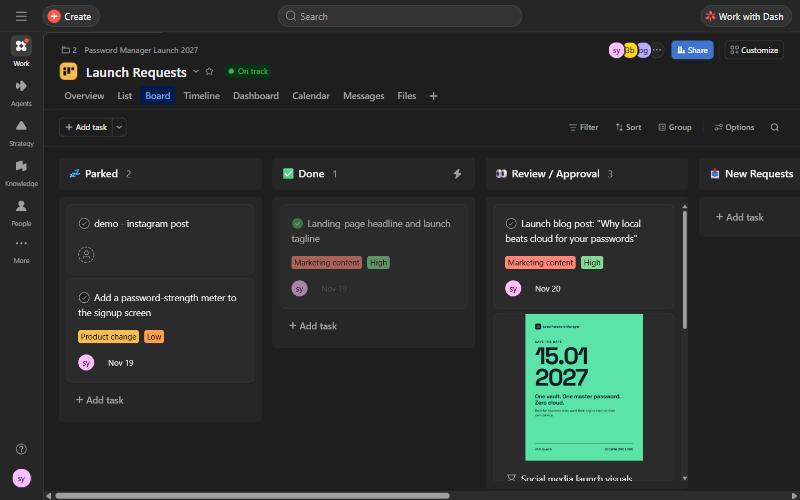 | 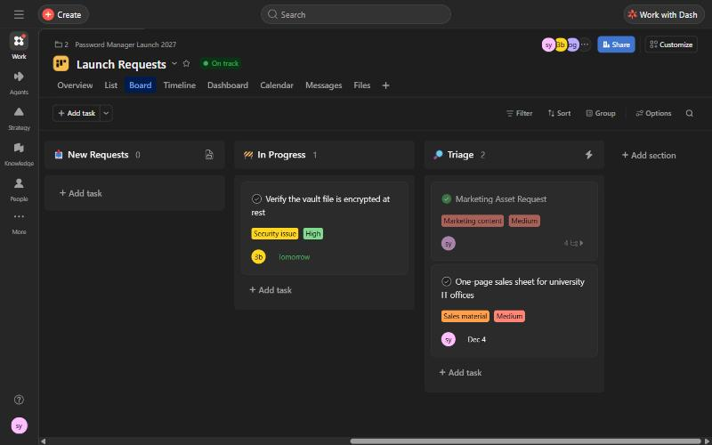 |

### Custom fields: categorisation and prioritisation

| Field | Options | Why |
|---|---|---|
| **Request Type** | Design asset · Marketing content · Sales material · Product change · Security issue | Rule R1 reads it to choose the owner |
| **Priority** | High · Medium · Low | Lets the Product Owner order the work, like a backlog |

A dropdown field has fixed values, so a rule can rely on it. Free text like "can someone do a poster?" can't be read by a rule.

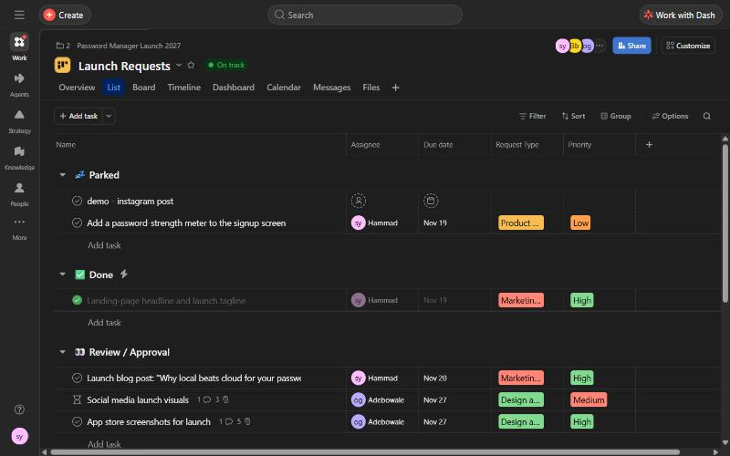

### Task template: a reusable workflow structure

**Marketing Asset Request** creates a ready-to-work task in one click (**+ Add task ▾ → Marketing Asset Request**).

- **Description:** Goal · Target audience · Definition of Done ("Copy and visuals are approved by the Product Owner for feature accuracy and handed over to Marketing").
- **Subtasks:**
  1. Draft copy
  2. Design visual (Design)
  3. Feature accuracy check (Product Owner)
  4. Publish

The **feature accuracy check** stops Marketing from promising something the product doesn't do, such as "cloud sync", which would break our vision.

| Template task | Subtasks and activity ("created this task using Marketing Asset Request") |
|---|---|
| 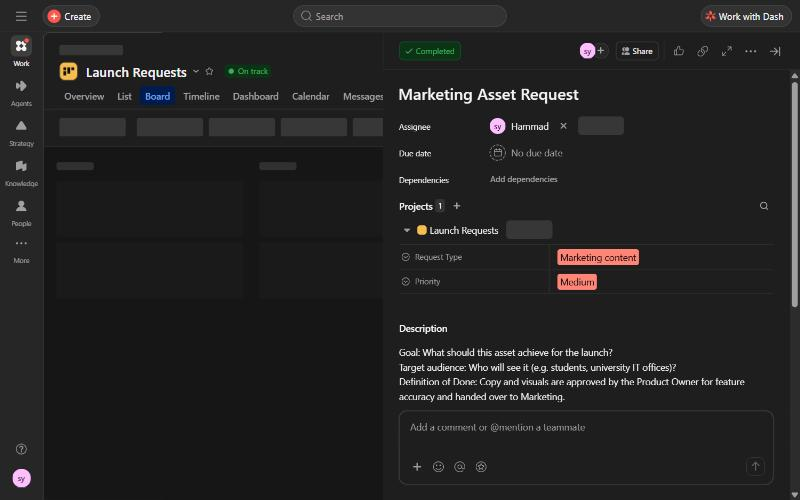 | 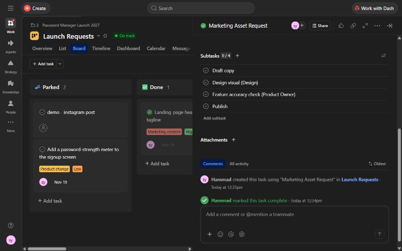 |

---

## 2. Forms and automation

### The Launch Request Form

The form is the single front door for Product, Design, Marketing and Sales. It has 5 required questions:
1. **Name:** becomes the task name.
2. **Email address**
3. **What type of request is this?** Maps to **Request Type**.
4. **What do you need?** The description of the request.
5. **Priority:** maps to **Priority**.

**Where to find it in Asana:**
- In **List view**, click the page icon next to the **New Requests** section header, then **Launch Request Form**.
- Or click **Customize → Forms → Launch Request Form**.

| Form icon on the New Requests section | Public form |
|---|---|
| 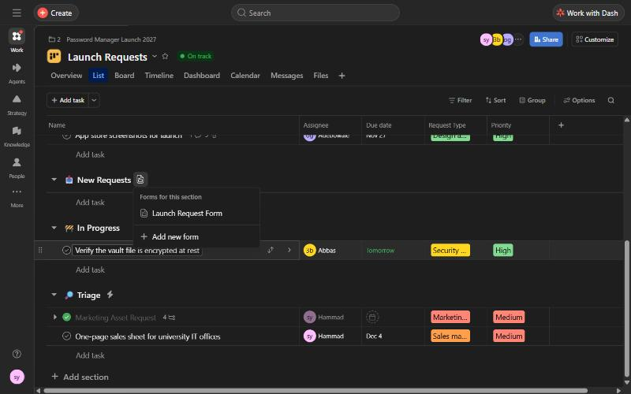 | 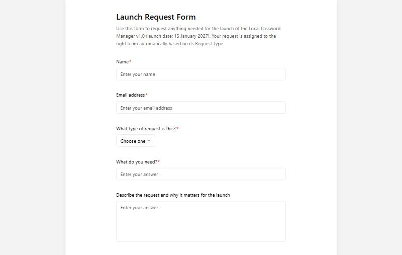 |

### Rules (trigger → condition → action)

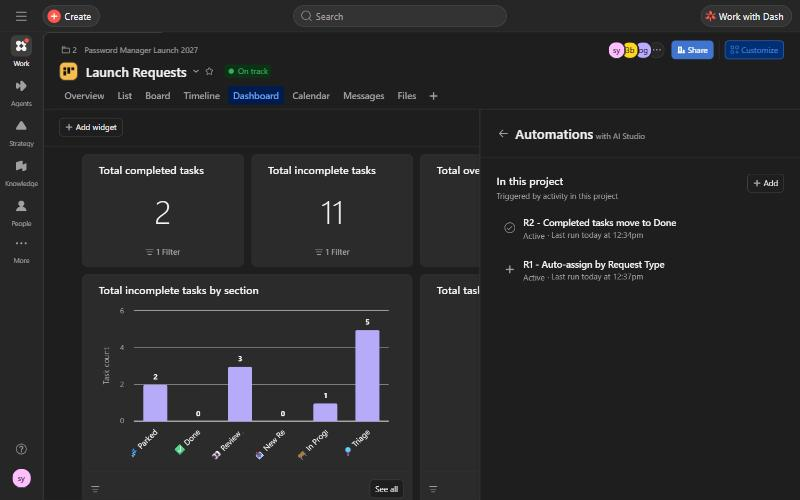

**R1: Auto-assign by Request Type**
- **Trigger:** a task is added to this project.
- **Conditions and actions:**

  | Request Type | Assign to | Then |
  |---|---|---|
  | Design asset | Adebowale (Design) | Move to Triage |
  | Product change or Security issue | Abbas (Product Owner) | Move to Triage |
  | Marketing content or Sales material | Hammad (Marketing & Sales) | Move to Triage |

- **Why Triage and not In Progress?** A person still checks every request. Automation removes the admin, not the judgement.

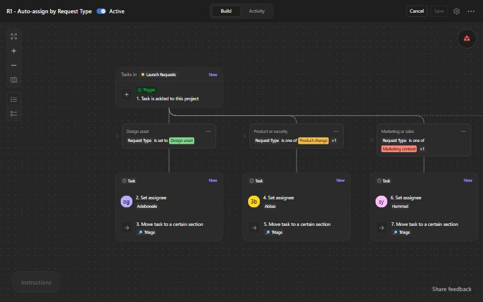

**R2: Completed tasks move to Done**
- **Trigger:** task completion status changes to *Complete*.
- **Action:** move the task to ✅ Done.
- **Why:** the board always shows the truth, and nobody has to remember to move cards.

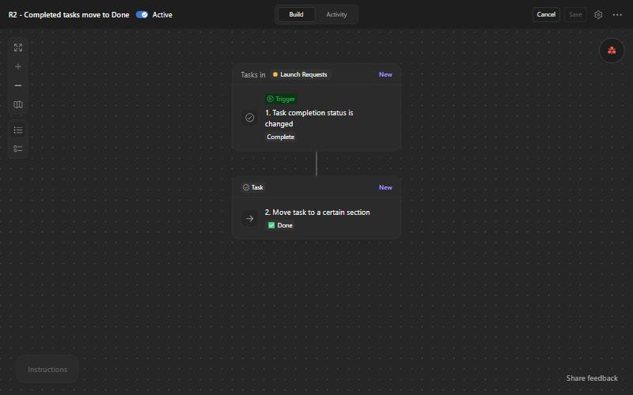

**Proof in the activity log:** this task was created from the template. Asana logged "R1 - Auto-assign by Request Type assigned this task to you", "R1 … moved this task to Triage" and "R2 - Completed tasks move to Done moved this task", with no human step.

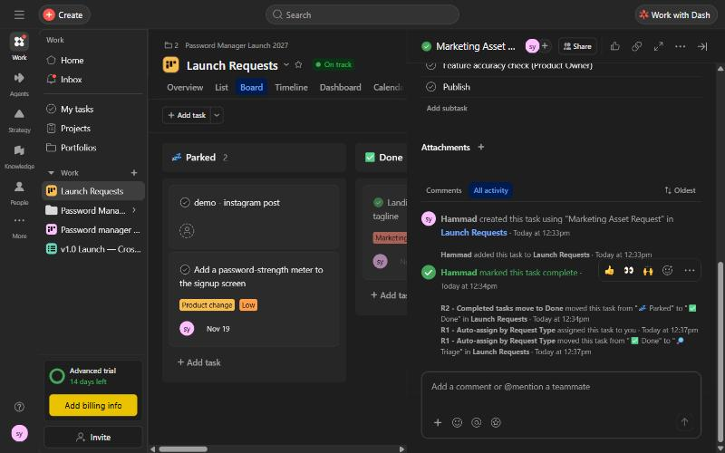

**Tested end to end:** a form submission (for example "Partner pricing sheet", Sales material, Medium) appeared in New Requests. Within seconds R1 assigned it to Hammad and moved it to Triage, and the activity log showed "Asana Rule". Marking it complete moved it to Done through R2.

---

## 3. Monitoring and continuous improvement

### How automation reduces manual effort

| Before | After |
|---|---|
| Collect requests from email and chat | The form collects them |
| Type each request into Asana | It becomes a task automatically |
| Decide the owner and assign | R1 assigns by Request Type |
| Move the card to the next stage | R1 moves it to Triage |
| Remember to move finished cards | R2 moves them to Done |

The result is fewer handovers, faster response, and every request handled the same way.

### How progress and bottlenecks are monitored

The **dashboard** shows total, completed, incomplete and overdue tasks, plus **incomplete tasks by section**. A bar that is much higher than the others means work is piling up at that stage.

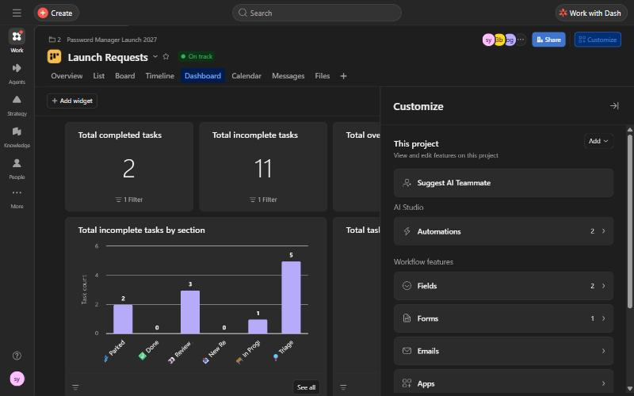

**Finding:** Review / Approval holds 3 waiting tasks:
- the launch blog post;
- the social media visuals;
- the app store screenshots.

So the bottleneck is **approvals, not the work itself**. More automation won't fix that. A daily approval slot for the Product Owner will.

### Limitation and risk of automation

- **Wrong input gives wrong output.** A wrong Request Type sends the task confidently to the wrong person.
- **Notification noise:** too many rules mean people stop reading notifications.
- **Hidden logic:** new team members don't see why things move.
- **Automating an unstable process** just speeds up the mess, and over-automation can reduce flexibility.

### How the workflow could be improved

1. A rule that moves **reopened** tasks back to In Progress.
2. A reminder to the Product Owner when a task sits in Review for **more than 2 days**.
3. A **WIP limit** on Review / Approval, plus a daily approval slot.
4. **Review every rule in each sprint retrospective**, with one person owning the rules.

---

## 4. Agile connection

- **Responding to change over following a plan:** a new or changed request reaches the right person in seconds instead of days. **Parked** lets us say "not now" without losing the idea.
- **Business people and developers work together daily:** Sales and Marketing use the same form and board as the product team.
- **Inspect and adapt:** the dashboard makes problems visible, and the retrospective changes the rules.

## 5. Reflection

**Which Asana automation features give agile teams the greatest value?**
Forms, custom fields and rules working together. The form is one front door, so nothing gets lost. The custom fields give each request a structure. The rules act on those fields instantly: R1 assigns and moves to Triage, and R2 moves finished work to Done. Task templates add value for recurring work.

**What should teams consider before automating?**
1. **Is the process stable?** Don't automate a process that's still changing.
2. **Is the input reliable?** That's why our form questions are required.
3. **Do humans keep key decisions?** Approvals and prioritisation stay with people, which is why we have Triage.
4. **Will the rules be reviewed regularly?** We review them in the retrospective, to avoid noise and hidden logic.

*Memory trick:*
- **Door → Data → Decision** (form → fields → rules).
- **Stable · Reliable input · Humans decide · Review.**
